<table width="100%" cellpadding="0" cellspacing="0" border="0">
  <tr>
    <td colspan="2" align="center">
      
    </td>
  </tr>

  <tr>
    <td width="50%" align="right">
      
    </td>
    <td width="50%" align="left">
      
    </td>
  </tr>

  <tr>
    <td colspan="2" align="center">
      
    </td>
  </tr>

  <tr>
    <td colspan="2" align="center">
      
    </td>
  </tr>

  <tr>
    <td colspan="2" align="center">
      
    </td>
  </tr>

  <tr>
    <td colspan="2" align="center">
      
    </td>
  </tr>

  <tr>
    <td colspan="2" align="center">
      
    </td>
  </tr>

  <tr>
    <td colspan="2" align="center">
      
    </td>
  </tr>
</table>