  

  
  

  

---

## What I Work On

- **Machine Learning:** Predictive modelling, feature engineering, model evaluation and optimization.
- **Deep Learning:** Neural networks, transfer learning and computer vision.
- **GenAI Engineering:** LLM-powered workflows, tool calling, agentic systems and application development.
- **Open Source:** Code contributions, bug fixes and tests across Python and machine learning libraries.

## Featured Projects

  

  

  

## Open Source

  

Contributing code fixes and improvements to projects including [scikit-learn](https://github.com/scikit-learn/scikit-learn), [Feature-engine](https://github.com/feature-engine/feature_engine) and [Recusal](https://github.com/philpaz/recusal).

[View all my pull requests](https://github.com/pulls?q=is%3Apr+author%3ARugvedBane).

## Technical Stack

| Area | Technologies |
|---|---|
| Languages | Python, SQL |
| Data & Analysis | NumPy, Pandas, Matplotlib |
| Machine Learning | Scikit-learn, XGBoost, LightGBM, Optuna |
| Deep Learning | PyTorch, TensorFlow, Keras |
| Computer Vision | OpenCV, YOLO |
| GenAI | LangChain, LLM APIs, Tool Calling |
| Backend & Apps | FastAPI, Streamlit |
| Tools | Git, GitHub, Jupyter, VS Code |

  I build Machine Learning and GenAI systems.

