  

  
   
  <a href="https://deepfake-audio-detector-rugved.streamlit.app/">Live demo ↗</a>

  
   
  <a href="https://ufc-predictor-rugvedbane.streamlit.app/">Live demo ↗</a>

  
   
  <a href="https://www.kaggle.com/code/rugvedbane/student-health-risk-lightgbm-optuna-0-95014">Kaggle notebook ↗</a>

  
   
  <a href="https://www.kaggle.com/code/rugvedbane/netflix-data-analysis">Kaggle notebook ↗</a>

